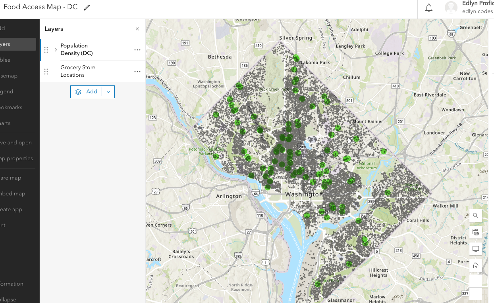

# Food Access and Population Distribution in Washington, DC

## Overview
This project explores spatial patterns in food access across Washington, DC by comparing grocery store locations with population density.

Using ArcGIS Online, I created a map to examine whether grocery stores are evenly distributed relative to where people live.

## Data Sources
- Grocery store locations: Open Data DC  
- Population density: ArcGIS Online (Esri data)

## Methodology
- Added grocery store point data  
- Added population density layer  
- Adjusted transparency and symbology for clarity  
- Conducted visual spatial analysis to identify patterns  

## Key Findings
- Grocery stores are concentrated in central areas  
- Some high-density areas appear to have fewer nearby grocery stores  
- This suggests potential gaps in food access across the DC metro area  

## Limitations
- Analysis is based on visual interpretation (no buffer analysis)  
- Limited to Washington, DC  
- Does not include additional variables such as transportation access or store size/quality  

## Map Preview

